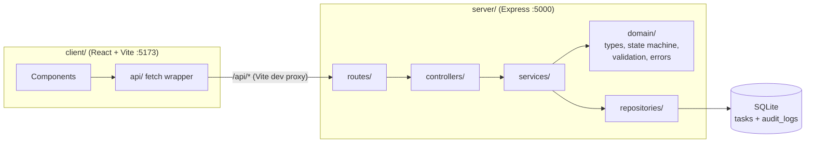
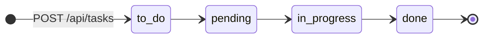

# Mini Task Manager — with an Immutable Audit Trail

A small full-stack task manager where every task moves through a strict forward-only workflow,
**To Do → Pending → In Progress → Done**. Every lifecycle event (creating a task, changing its status,
and deleting it) is permanently recorded in an append-only audit trail.

The focus is **domain integrity and data consistency**, not visual gimmicks: the backend is the single
source of truth for every rule, each write and its audit entry are committed atomically, and the
audit log is protected against modification at the API, code, and database level.

---

## Table of contents

1. [Project overview & architecture](#1-project-overview--architecture)
2. [Setup and execution guide](#2-setup-and-execution-guide)
3. [API reference](#3-api-reference)
4. [Domain modeling & state transition validation](#4-domain-modeling--state-transition-validation)
5. [Assessment questions](#5-assessment-questions)
6. [Trade-offs and assumptions](#6-trade-offs-and-assumptions)
7. [What I would improve with more time](#7-what-i-would-improve-with-more-time)
8. [Testing](#8-testing)

---

## 1. Project overview & architecture

### Features

- **Kanban board** with four columns, plus a global **Activity** feed (toggle between the two views).
- **"Advance to <next status>"** button on every task. The button is the primary way to move tasks.
  Drag-and-drop between columns is also supported. Drops are sent to the server as-is, so an invalid
  drop (for example To Do → Done) is rejected by the backend and shown as an error toast.
- **Global actor selector** in the header ("Aldy Samuel", "Budi Santoso", "Johan Sutheja"). Creating,
  moving, and deleting a task are all attributed to the selected actor, and the selection is
  remembered per browser.
- **Who did what, on every card**: "Created by [actor]" and, once the task has moved,
  "Moved to [status] by [actor] · [time]". Both are derived from the audit trail.
- **Audit trail viewer** per task (the "History / Logs" button) and a global Activity feed. Entries are
  rendered as:
  - creation: `User "[actor]" created Task "[taskTitle]" at [YYYY-MM-DD HH:mm]`
  - status change: `User "[actor]" changed Task "[taskTitle]" status from "[from]" to "[to]" at [YYYY-MM-DD HH:mm]`
  - deletion: `User "[actor]" deleted Task "[taskTitle]" (status "[fromStatus]") at [YYYY-MM-DD HH:mm]`

  For example, `User "Aldy Samuel" changed Task "Prepare Invoice" status from "pending" to "in_progress" at 2025-01-01 10:00`.
  Audit lines use the raw status values, exactly like the spec; badges, column headers, and buttons
  show human labels ("In Progress"). `taskTitle` is the snapshot stored with the entry, and the time
  is shown in the viewer's local time zone.
- **Strict backend validation**: skipped steps and backward moves return `400 Bad Request`. A request
  for the status the task already has is an idempotent `200` that writes no log.
- **Delete without losing history**: deleted tasks are archived, so their audit trail stays queryable.
  The deletion itself is recorded too, with the actor and the status the task had.
- **Persistence** in a local SQLite file, so data survives restarts with no database setup.

### Tech stack

| Layer     | Technology                                                                 |
| --------- | -------------------------------------------------------------------------- |
| Backend   | Node.js, Express 5, TypeScript                                             |
| Storage   | SQLite through `better-sqlite3` (synchronous, transactional, file-based)   |
| Frontend  | React 19, TypeScript, Vite, Tailwind CSS v4, lucide-react                  |
| Testing   | Vitest + Supertest (domain unit tests, HTTP integration tests, DB tests)   |
| Tooling   | `tsx` (dev server with watch), `concurrently` (runs client and server)     |

There is no authentication, no JWT, and no roles. This is deliberate and follows the brief.

### Architecture



Each layer has one job:

| Layer            | Responsibility                                                                                 |
| ---------------- | ---------------------------------------------------------------------------------------------- |
| `domain/`        | Pure TypeScript: types, the workflow state machine, input validation, domain errors. No I/O.   |
| `repositories/`  | SQL only: schema, triggers, prepared statements. The audit repository has no update or delete. |
| `services/`      | Use cases. Runs read → validate → update → append-log inside a single transaction.             |
| `controllers/`   | Converts HTTP to service calls and back. Maps domain errors to HTTP status codes.               |
| `routes/`        | URL → controller wiring. `app.ts` is the composition root (dependency injection by hand).      |

### Project structure

```
.
├── package.json              # root scripts: install:all, dev, build, start, test
├── server/
│   ├── src/
│   │   ├── domain/           # types.ts, taskStateMachine.ts, validation.ts, errors.ts
│   │   ├── repositories/     # database.ts (schema + triggers), taskRepository.ts, auditLogRepository.ts
│   │   ├── services/         # taskService.ts (atomic create / status change + audit), auditLogService.ts
│   │   ├── controllers/      # taskController.ts, auditLogController.ts, errorHandler.ts
│   │   ├── routes/           # index.ts, taskRoutes.ts, auditLogRoutes.ts
│   │   ├── app.ts            # composition root (createApp), also used by the tests
│   │   └── server.ts         # entry point: Node version check, config, DB, listen, graceful shutdown
│   ├── tests/                # state machine, API, and DB-level immutability tests
│   ├── .npmrc                # ignore-scripts=true: use better-sqlite3's prebuilt binary (see Trade-offs)
│   ├── package.json
│   └── tsconfig.json
└── client/
    ├── src/
    │   ├── components/       # Navbar, ViewSwitcher, KanbanBoard, TaskCard, TaskModal,
    │   │                     # AuditTrailModal, ActivityFeed, ConfirmDeleteDialog, Modal, Button, ...
    │   ├── types/            # interfaces mirrored from the server domain
    │   ├── api/              # fetch wrapper (ApiError) + typed endpoint functions
    │   ├── hooks/            # useActor (persisted actor), useToasts
    │   ├── lib/              # status labels/colors, audit entry + timestamp formatting
    │   ├── App.tsx           # state container: data loading, actions, modals, toasts
    │   └── main.tsx
    ├── vite.config.ts        # React + Tailwind plugins, /api proxy to :5000
    └── package.json
```

---

## 2. Setup and execution guide

### Prerequisites

- **Node.js 22.14+, 24.x, or 26.x**, matching `engines` in every `package.json`. It was developed and
  tested on Node 24.14.1, which is the version `.nvmrc` pins. A clean install, the tests, the dev
  server, and `npm start` were also verified on Node 26.11.1.
  - The server checks the Node version at startup, before `better-sqlite3` is loaded, and exits with a
    clear message on any other version (including 23, 25, and 27+). The bundled `better-sqlite3`
    binary needs Node-API 10, so on Node 22.12–22.13 it would otherwise crash with a segmentation fault.
  - Node 23 and 25 are also unsupported by the test runner (Vitest 5).
- **No C++ toolchain needed.** `better-sqlite3` ships prebuilt binaries for Windows (x64, arm64),
  macOS (x64, arm64), and Linux (x64, arm64; glibc and musl). `server/.npmrc` makes npm use them
  instead of compiling (see [trade-offs](#6-trade-offs-and-assumptions)). Other platforms are not
  supported.
- **npm 10+** (bundled with Node).
- Free ports **5000** (API) and **5173** (web app).

### Installation and development run

```bash
# 1. Install root, server, and client dependencies
npm run install:all

# 2. Start the API (:5000) and the web app (:5173) together
npm run dev
```

Open **http://localhost:5173**. The Vite dev server proxies every `/api/*` request to
`http://127.0.0.1:5000`, so the browser never needs CORS.

On first start the SQLite database is created at `server/data/tasks.db` along with its schema. To
reset all data, stop the app and delete the `server/data/` folder.

> **Upgrading from an earlier version of this project:** the audit schema changed. Creation and then
> deletion became audited, so `audit_logs.from_status` and `audit_logs.to_status` are both nullable
> now (schema version 3). The schema is not migrated in place. **Stop the app and delete the
> `server/data/` folder** before starting it again. If you forget, the server refuses to start and
> prints this instruction instead of failing later with a 500.

### Production-style run

```bash
npm run build   # compiles the server to server/dist and bundles the client to client/dist
npm start       # Express serves both the API and the built React app on http://localhost:5000
```

### Scripts (root)

| Command               | What it does                                                            |
| --------------------- | ----------------------------------------------------------------------- |
| `npm run install:all` | Installs dependencies for root, `server/`, and `client/`                |
| `npm run dev`         | Runs the server (`tsx watch`) and client (`vite`) concurrently          |
| `npm run build`       | Type-checks and builds both apps                                        |
| `npm start`           | Starts the compiled server, which also serves `client/dist` if present  |
| `npm test`            | Runs the backend test suite (Vitest + Supertest)                        |
| `npm run typecheck`   | Type-checks server (including tests) and client                         |

### Configuration (optional environment variables)

| Variable           | Default                     | Used by | Purpose                                     |
| ------------------ | --------------------------- | ------- | ------------------------------------------- |
| `PORT`             | `5000`                      | server  | HTTP port of the API                        |
| `DB_PATH`          | `server/data/tasks.db`      | server  | SQLite file location                        |
| `API_PROXY_TARGET` | `http://127.0.0.1:5000`     | client  | Where the Vite dev server proxies `/api`    |

> **macOS note:** AirPlay Receiver listens on port 5000 by default. If the server reports that the
> port is in use, disable AirPlay Receiver or run with `PORT=5001` and `API_PROXY_TARGET=http://127.0.0.1:5001`.

### Troubleshooting

**The web app says "The server is unavailable. Is the backend running?"** The web app is running, but the
API on port 5000 is not answering. The web app keeps running even when the API failed to start, so check
the `[server]` lines in the terminal where you ran `npm run dev`:

- **"…schema is outdated…"**: stop the app, delete the `server/data/` folder, and run `npm run dev` again.
- **"Port 5000 is already in use"**: stop the other process, or use another port, for example
  `PORT=5001 API_PROXY_TARGET=http://127.0.0.1:5001 npm run dev`. In PowerShell, use
  `$env:PORT="5001"; $env:API_PROXY_TARGET="http://127.0.0.1:5001"; npm run dev`.
- **No `[server]` lines at all**: `npm run dev` was started inside `client/`. Run it from the project root.

**The server exits with "Node.js 22.14+, 24.x, or 26.x is required (found vX.Y.Z)"**: the startup check
found an unsupported Node version. Run `nvm use`, which picks 24.14.1 from `.nvmrc`, or install Node
22.14+, 24.x, or 26.x, then start again.

**`npm run install:all` fails with `gyp ERR! …`** (for example "Could not find any Visual Studio
installation"): npm is trying to compile `better-sqlite3`. Check that `server/.npmrc` exists. It is a
dotfile and is easy to lose when copying the project.

---

## 3. API reference

Base URL: `http://localhost:5000/api` (or `http://localhost:5173/api` through the dev proxy).

| Method   | Path                          | Body                                       | Success                         |
| -------- | ----------------------------- | ------------------------------------------ | ------------------------------- |
| `GET`    | `/tasks?order=desc\|asc`      | —                                          | `200` active tasks by `createdAt` (default `desc`) |
| `POST`   | `/tasks`                      | `{ title: string, description?: string, actor: Actor }` | `201` task (status `to_do`) + `Location` header; writes the creation entry |
| `PATCH`  | `/tasks/:id`                  | `{ title?: string, description?: string \| null }` | `200` task (details only, never status; not audited) |
| `PUT`    | `/tasks/:id/status`           | `{ status: TaskStatus, actor: Actor }`     | `200` task (changed or idempotent no-op) |
| `DELETE` | `/tasks/:id`                  | `{ actor: Actor }`                         | `204`; archives the task and writes the deletion entry. Unknown or already-deleted task: `404`, nothing written |
| `GET`    | `/tasks/:id/audit-logs`       | —                                          | `200` chronological trail: creation entry first, deletion entry last if deleted (works for deleted tasks too) |
| `GET`    | `/audit-logs?limit=100`       | —                                          | `200` global feed, newest first (limit 1–500) |
| `GET`    | `/health`                     | —                                          | `200 { "status": "ok" }`        |

Every endpoint that returns a task returns it with two fields derived from the audit trail:

```json
{
  "id": 1, "title": "Write report", "description": null, "status": "pending",
  "createdAt": "2026-10-11T13:15:00.000Z", "updatedAt": "2026-10-11T13:20:00.000Z",
  "createdBy": "Budi Santoso",
  "lastChange": {
    "id": 2, "taskId": 1, "taskTitle": "Write report", "actor": "Johan Sutheja",
    "fromStatus": "to_do", "toStatus": "pending", "timestamp": "2026-10-11T13:20:00.000Z"
  }
}
```

- `createdBy` is the actor of the task's first audit entry (its creation).
- `lastChange` is the most recent status-change entry, or `null` while only the creation entry exists.
- `GET /tasks` computes both for all tasks in **a single SQL statement** (no N+1). Each lookup is an
  index seek on `audit_logs (task_id, id)`.

The global feed (`GET /audit-logs`, the Activity view) is newest-first, while the per-task trail
(`GET /tasks/:id/audit-logs`, the History / Logs modal) is chronological (oldest-first), as the spec
requires for the per-task view.

Any `POST`, `PUT`, `PATCH`, or `DELETE` on `/audit-logs` or `/audit-logs/:id` returns
**`405 Method Not Allowed`** (`Allow: GET`, code `AUDIT_LOG_IMMUTABLE`).

**Error format** (all errors):

```json
{
  "error": {
    "code": "INVALID_STATUS_TRANSITION",
    "message": "Invalid status transition from 'to_do' to 'done': workflow steps cannot be skipped. The only allowed next status is 'pending'.",
    "details": { "taskId": 1, "currentStatus": "to_do", "requestedStatus": "done", "allowedNextStatus": "pending" }
  }
}
```

| HTTP  | `code`                                     | When                                               |
| ----- | ------------------------------------------ | -------------------------------------------------- |
| `400` | `VALIDATION_ERROR`, `INVALID_JSON`         | Malformed body, missing/unknown actor, unknown status, bad id/query |
| `400` | `INVALID_STATUS_TRANSITION`                | Backward move, skipped step, or move out of `done` |
| `404` | `TASK_NOT_FOUND`, `ROUTE_NOT_FOUND`        | Unknown or deleted task, unknown route             |
| `405` | `AUDIT_LOG_IMMUTABLE`                      | Any write attempt on audit logs                    |
| `409` | `CONCURRENT_MODIFICATION`                  | Defensive compare-and-set guard (see Q2)           |

### Try it with curl

```bash
API=http://localhost:5000/api

curl -X POST $API/tasks -H 'Content-Type: application/json' -d '{"title":"Write report"}'                             # 400 (actor required)
curl -X POST $API/tasks -H 'Content-Type: application/json' -d '{"title":"Write report","actor":"Budi Santoso"}'      # 201 + creation entry
curl -X PUT  $API/tasks/1/status -H 'Content-Type: application/json' -d '{"status":"done","actor":"Aldy Samuel"}'     # 400 (skip)
curl -X PUT  $API/tasks/1/status -H 'Content-Type: application/json' -d '{"status":"pending","actor":"Aldy Samuel"}'  # 200 + 1 log
curl -X PUT  $API/tasks/1/status -H 'Content-Type: application/json' -d '{"status":"pending","actor":"Aldy Samuel"}'  # 200, no new log
curl -X PUT  $API/tasks/1/status -H 'Content-Type: application/json' -d '{"status":"to_do","actor":"Aldy Samuel"}'    # 400 (backward)
curl $API/tasks/1/audit-logs
curl -X DELETE $API/audit-logs/1                                                                                      # 405
curl -X DELETE $API/tasks/1                                                                                           # 400 (actor required)
curl -X DELETE $API/tasks/1 -H 'Content-Type: application/json' -d '{"actor":"Johan Sutheja"}'                       # 204 + deletion entry
curl -X DELETE $API/tasks/1 -H 'Content-Type: application/json' -d '{"actor":"Johan Sutheja"}'                       # 404, nothing written
curl $API/tasks/1/audit-logs                                                                                          # history still there, ending with the deletion
```

(In Windows PowerShell, call `curl.exe` and escape the inner quotes, or run these lines in Git Bash.)

---

## 4. Domain modeling & state transition validation

### Entities

```ts
type TaskStatus = 'to_do' | 'pending' | 'in_progress' | 'done';
type Actor = 'Aldy Samuel' | 'Budi Santoso' | 'Johan Sutheja';

interface AuditLog {                  // immutable once written
  id: number; taskId: number;
  taskTitle: string;                  // snapshot of the title at the time of the entry
  actor: Actor;
  fromStatus: TaskStatus | null;      // null only for the creation entry
  toStatus: TaskStatus | null;        // 'to_do' for the creation entry; null only for the deletion entry
  timestamp: string;                  // ISO 8601 (UTC)
}

interface Task {
  id: number; title: string; description: string | null;
  status: TaskStatus; createdAt: string; updatedAt: string;   // ISO 8601 (UTC)
  createdBy: Actor | null;            // derived: actor of the first audit entry
  lastChange: AuditLog | null;        // derived: latest status change (both statuses set)
}
```

A task's audit trail has one entry per **lifecycle event**:

| Event | `fromStatus` | `toStatus` | How often |
| --- | --- | --- | --- |
| Creation | `null` | `'to_do'` | exactly once, first |
| Status change | previous status | new status | once per real change |
| Deletion | status at deletion | `null` | at most once, last |

`createdBy` and `lastChange` are not stored on the task row. They are read from the audit trail, so they
can never disagree with it.

The database enforces the shape of entries. A SQLite CHECK only fails when it evaluates to *false*; a
`NULL` result passes. So the rule that the two statuses can't both be `NULL` needs its own constraint:

- `CHECK (from_status IS NOT NULL OR to_status IS NOT NULL)`: no `null → null` entry.
- `CHECK (from_status IS NOT NULL OR to_status = 'to_do')`: a `null` from-status is only possible for
  the creation entry.
- `CHECK (from_status IS NULL OR to_status IS NULL OR from_status <> to_status)`: every status change is
  a real change.

A `null` to-status marks the deletion entry.

There is deliberately **no assignee/PIC field and no rule about who may move a task**. Any of the
predefined actors can create, move, or delete any task, and the audit trail records who did it.

### The state machine



The workflow is defined once, as the order of the `TASK_STATUSES` tuple in
`server/src/domain/types.ts`. A task may only move **exactly one position to the right**.
`decideTransition(from, to)` in `server/src/domain/taskStateMachine.ts` is a pure function with three
possible outcomes:

| Requested change                    | Decision     | HTTP result                         | Audit log |
| ----------------------------------- | ------------ | ----------------------------------- | --------- |
| `to === from`                       | `unchanged`  | `200` + current task (idempotent)   | none      |
| `to` is the next status             | `advance`    | `200` + updated task                | 1 entry   |
| `to` is earlier than `from`         | `rejected`   | `400` "backward transitions are not allowed" | none |
| `to` is two or more steps ahead     | `rejected`   | `400` "workflow steps cannot be skipped"     | none |
| `from` is `done` and `to` differs   | `rejected`   | `400` "final status"                | none      |

### What happens on `POST /api/tasks`

1. **Controller** validates the body: a non-empty `title` (≤ 200 characters), an optional
   `description` (≤ 2000), and an `actor` from the predefined list. Otherwise the response is
   `400 VALIDATION_ERROR` and nothing is written.
2. **Service** runs one transaction: insert the task with status `to_do`, then append the creation
   entry (`actor`, `fromStatus: null`, `toStatus: 'to_do'`, title snapshot, same timestamp as `createdAt`).
3. Commit and return `201` with the task (`createdBy` set, `lastChange: null`). A task never exists
   without its creation entry.

### What happens on `PUT /api/tasks/:id/status`

1. **Controller** parses the id and body: `status` must be a known `TaskStatus` and `actor` one of the
   three predefined actors. Otherwise the response is `400 VALIDATION_ERROR`.
2. **Service** opens a `BEGIN IMMEDIATE` transaction, which takes SQLite's write lock *before reading*:
   1. Load the active task. If it doesn't exist or was deleted, return `404`.
   2. `decideTransition(current, requested)`:
      - `unchanged`: return the task as-is. Nothing is written (**idempotency**).
      - `rejected`: throw `InvalidTransitionError`, which becomes `400` with the reason and the allowed
        next status.
   3. Compare-and-set update: `UPDATE tasks SET status = ? … WHERE id = ? AND status = <validated status>`.
   4. Insert the audit entry (actor, from, to, title snapshot, timestamp) in **the same transaction**.
3. Commit. Either both the status change and its audit entry exist, or neither does.

### What happens on `DELETE /api/tasks/:id`

1. **Controller** parses the id and the body: `actor` must be one of the predefined actors. Otherwise
   the response is `400 VALIDATION_ERROR` and nothing is written.
2. **Service** opens a `BEGIN IMMEDIATE` transaction:
   1. Load the active task. If it doesn't exist or was already deleted, return `404`. Nothing is written.
   2. Archive the task (`deleted_at` is set).
   3. Append the deletion entry (`actor`, `fromStatus: <current status>`, `toStatus: null`, title
      snapshot, timestamp) in **the same transaction**.
3. Commit and return `204`. If the insert fails, the archive is rolled back with it.

The frontend never decides whether a move is valid. It only computes the *label* of the "Advance to …"
button. Drag-and-drop deliberately sends whatever column the card was dropped on, so the server's
validation is visible in the UI: an invalid drop triggers an error toast and the board resyncs.

### Deleting and renaming tasks without touching history

- `DELETE /api/tasks/:id` **archives** the task (`deleted_at` is set) and records who deleted it. The
  task disappears from the board and can't be changed any more (`404`). Its audit trail, now ending
  with the deletion entry, stays available through `/api/tasks/:id/audit-logs` and the global
  Activity feed.
- `AUTOINCREMENT` ids are never reused, so a new task can never inherit a deleted task's history.
- `PATCH /api/tasks/:id` changes title and description only. Existing log entries keep the title they
  were recorded with (`taskTitle` snapshot), and the audit trail displays that snapshot
  (`… changed Task "[taskTitle]" status …`), so a renamed task's history shows its old title.
- Detail edits (title/description) don't write audit entries (see
  [assumptions](#6-trade-offs-and-assumptions)). No operation ever modifies or removes an existing entry.

---

## 5. Assessment questions

### Q1. Bagaimana kamu memastikan audit log tidak ter-modifikasi?
*How do you ensure the audit log cannot be modified?*

Immutability is enforced in several independent layers, so a bug in one layer is caught by the next:

1. **No write surface in the API.** There are no endpoints that create, edit, or delete audit logs.
   Audit entries are only produced as a side effect of a lifecycle event: creating a task, a
   successful status change, or deleting a task. Any `POST/PUT/PATCH/DELETE` on `/api/audit-logs` or
   `/api/audit-logs/:id` returns an explicit `405 Method Not Allowed` with code `AUDIT_LOG_IMMUTABLE`.
2. **Append-only by construction in code.** `AuditLogRepository` exposes only `append()` and read
   methods. There is no `update` or `delete` method to call by mistake, and the only callers of
   `append()` are the create-task, status-change, and delete-task transactions in `TaskService`.
3. **Append-only enforced by the database.** `audit_logs` has `BEFORE UPDATE` and `BEFORE DELETE`
   triggers that execute `RAISE(ABORT, 'audit_logs is append-only …')`. Even a raw SQL statement issued
   by the application, a script, or a future developer is rejected. `CHECK` constraints also reject
   entries that use unknown statuses, that have both statuses `null`, that are not a real change
   (`from_status <> to_status`), or that have a `null` from-status for anything other than the
   creation entry (`to_status = 'to_do'`). A `null` to-status is only the deletion entry.
4. **History can't be removed indirectly.** `audit_logs.task_id` is a foreign key with
   `ON DELETE RESTRICT`, so a task with history can't be hard-deleted and logs can't be cascaded
   away. Tasks are archived instead. Title snapshots mean renaming a task never rewrites past
   entries, and `AUTOINCREMENT` prevents id reuse from mixing histories.
5. **Atomicity.** Each lifecycle write is committed in one transaction with its entry: a task insert
   with its creation entry, a status update with its log entry, and an archive with its deletion entry.
   There is never a task without its creation entry, a status change or deletion without its audit
   entry, or an audit entry for a write that was rolled back.
6. **Proven by tests.** `server/tests/auditLogImmutability.test.ts` runs raw `UPDATE`/`DELETE`
   statements against SQLite and asserts that they fail, and checks the `CHECK` constraints. The API
   tests assert the `405` responses and that log counts only change on creation, real transitions,
   and deletion.

**Honest limitation:** anyone with direct file-system access to the SQLite file can drop the triggers.
For tamper-*evidence* in a real system I would add a **hash chain** (each row stores
`sha256(previous_hash + row_content)`, verified periodically), use a PostgreSQL role that only has
`INSERT, SELECT` on the audit table (`REVOKE UPDATE, DELETE`), and ship entries to WORM storage
(for example S3 Object Lock).

### Q2. Bagian mana dari solusi ini yang paling berisiko jika digunakan oleh banyak user?
*Which part of this solution is the riskiest when used by many users?*

The riskiest part is the **status-change path**: read the current status, validate, update, and append
a log. With concurrent users, this is where race conditions happen.

**The race:** users A and B both see a task in `to_do` and both click "Advance to Pending". Without
protection, both requests read `to_do`, both pass validation, and two `to_do → pending` log entries are
written. That corrupts the audit trail.

**How the current solution handles it:**
- The whole read-validate-write runs in a **`BEGIN IMMEDIATE` transaction**. SQLite grants the write
  lock before the read, so concurrent writers (even from other processes) are serialized. Inside one
  Node process, `better-sqlite3` is synchronous, so a transaction can't interleave with another request.
- The update is a **compare-and-set** (`WHERE status = <the status we validated>`). If the row changed
  anyway, the update affects 0 rows and the request fails with `409` instead of writing a wrong log.
- The **idempotency rule resolves the double click**. B's request arrives after A's commit, sees
  `pending`, and returns `200` with no new log. Exactly one entry is recorded.
- A **stale UI** (B still sees `to_do` but the task is already `in_progress`) sends a move that is now
  backward or skipping, so it is rejected with `400`. The client shows the error and reloads the board.
- **Task creation has no such race.** It reads no prior state, and the task insert and its creation
  entry share one transaction.
- **Deletion is serialized the same way.** Of two concurrent deletes, only the first writes a deletion
  entry; the second finds the task archived and gets `404`. With 10 parallel requests, exactly one got
  `204` and one entry was written.

**Risks that remain at scale:**
1. **SQLite is a single-writer database on a single machine.** All writes are serialized. Under heavy
   write load requests queue up (bounded by `busy_timeout = 5000` ms, then `SQLITE_BUSY`). The
   synchronous driver blocks the event loop during each write, and the file cannot be safely shared
   by several app servers.
2. **No optimistic version check from the client.** The request carries the target status but not
   the version the user was looking at. Two users with the same intent are handled correctly, but the
   API can't tell "you acted on stale data" apart from "already done". A `version`/`ETag` with
   `If-Match` (returning `409`) would make that explicit.
3. **Log ordering in a distributed setup.** Today the order is the insertion `id`, and the timestamp is
   taken inside the write lock, so the order is consistent. With several app servers (clock skew) or
   asynchronous log delivery, timestamps and arrival order can disagree. A per-task sequence number
   would be needed.
4. **The actor is self-declared.** Without authentication (by design in this brief), any client can
   claim any of the three actors when creating, moving, or deleting a task. With many real users
   this is the biggest *trust* risk: the audit log records who someone *said* they were, including
   the `createdBy` shown on every card.
5. **Unbounded growth.** The audit table only grows. The global feed uses `LIMIT` but no cursor
   pagination or archival/partitioning yet.

### Q3. Jika task ini berkembang menjadi sistem besar, bagian mana yang akan kamu refactor terlebih dahulu dan kenapa?
*If this grows into a large system, what would you refactor first, and why?*

In this order:

1. **Persistence: SQLite → PostgreSQL** (first, because concurrency is the first thing that breaks).
   The repository layer is already the only code that knows about SQL, so this is a contained change:
   - ACID transactions with row-level locking (`SELECT … FOR UPDATE`, or a compare-and-set
     `UPDATE … WHERE status = $expected RETURNING *`) instead of a database-wide write lock.
   - A `version` column for optimistic locking exposed via `ETag`/`If-Match`.
   - The audit table owned by a role with `INSERT, SELECT` only, partitioned by month, plus proper
     migrations (for example `node-pg-migrate` or Prisma Migrate) and connection pooling.
   - Horizontal scaling of stateless API instances behind a load balancer.
2. **Audit logging as events (transactional outbox → Kafka/RabbitMQ).** Once other consumers need
   status changes (notifications, analytics, search, a compliance store), the service should emit a
   `TaskStatusChanged` event instead of each consumer querying the database. I would use the
   **transactional outbox pattern**: write the status change and an outbox row in the same
   transaction, and a relay publishes outbox rows to the broker. Publishing directly after commit
   (a "dual write") can lose events if the process crashes in between, which would break the core
   guarantee that every status change has an audit record. Consumers must be idempotent (keyed by
   event id) and order by a per-task sequence number.
3. **Domain-driven design boundaries.** Move from a service with a pure state-machine function to a
   `Task` aggregate (`task.advanceTo(status, actor)`) that enforces invariants and raises domain
   events. Separate the **Task Management** and **Audit/Compliance** bounded contexts, each with its
   own storage and API, and connect them through the events above.
4. Alongside these: **real authentication** (OIDC/SSO), so the actor comes from a verified identity
   instead of the request body.

### Q4. Jika kamu menggunakan AI, jelaskan bagian mana yang dibantu AI dan bagaimana kamu memvalidasinya?
*If you used AI, which parts did it help with and how did you validate them?*

<!-- TODO: written by author -->
**Gaps I found through manual testing**

Two of the most important changes in this project came from me using the app, not from the
original specification.

*1. Task creation was not recorded.*
While testing, I created a task as "Johan Sutheja" and then opened the Activity feed. Only status
changes appeared, so there was no way to tell who had created the task. At first I suspected the
actor wasn't being sent correctly, so I checked the request payload in the browser DevTools.
The payload was correct: the status change had been made under "Aldy Samuel" because that was
the actor selected at the time. So attribution worked as designed, but the creation event itself
was simply never recorded.

I considered two options: adding a `created_by` column to the tasks table, or writing creation as
the first audit entry (`null → to_do`). I chose the audit entry, because it keeps the audit log as
the single source of truth for "who did what". The "Created by" label on each card is read from
that first entry instead of being stored twice. The cost was making `from_status` nullable, so I
added a CHECK constraint that only allows a null `from_status` when `to_status` is `to_do`.

*2. Task deletion was not recorded either.*
Later I deleted a task and noticed the Activity feed didn't show who deleted it. I applied the same
pattern in reverse: deletion writes an entry from the task's last status to `null`, in the same
transaction as archiving the task.

This gave me a clear rule I can defend: the task's lifecycle (creation, status changes, deletion)
is always audited, while edits to the title or description are not. Those edits can't corrupt the
history, because every audit entry keeps a snapshot of the title at the time it was written.

I discussed these options with Claude (chat) before deciding, and Claude Code implemented them.
I then verified each change myself: creating a task as one actor, moving it as another, deleting it
as a third, and checking that the Activity feed and the task's history showed all three actors
correctly.


---

## 6. Trade-offs and assumptions

**Trade-offs**

- **SQLite + synchronous `better-sqlite3`.** Zero setup, real transactions, constraints, and triggers.
  The cost is a single writer on a single node (see Q2/Q3). This is acceptable for an assessment-sized
  app, and the repository layer isolates the choice.
- **Archive instead of hard delete.** It keeps foreign-key integrity between logs and tasks, keeps
  history resolvable, and lets the API tell "deleted" (history still available) apart from "never
  existed" (`404`). The cost is that archived rows stay in the table.
- **One `PATCH /api/tasks/:id` endpoint beyond the listed ones.** The brief says that *updating task
  details* must not overwrite historical logs. Without an update endpoint that rule couldn't be
  exercised or tested. It changes only title and description and rejects `status`.
- **Idempotent no-op and real change return the same `200` + task body**, exactly as specified. The
  client can't distinguish them, which is harmless because the resulting state is the same.
- **The client sends the target status, not an "advance" command.** This matches the brief and is what
  makes idempotency and stale-client detection possible.
- **Drag-and-drop without client-side validation.** This is intentional, so the server is visibly the
  authority. HTML5 drag-and-drop doesn't work on touch screens. The button remains the primary,
  accessible path.
- **No state-management or UI library** (plain `useState`, `fetch`, native `<dialog>`). This keeps the
  dependency surface small for an app of this size.
- **Separate `npm install` per package instead of npm workspaces**, to match the required
  `npm run install:all` workflow. As a result, types are mirrored in `client/src/types` rather than
  shared.
- **`createdBy` / `lastChange` are derived from the audit trail at read time, not stored on the task.**
  The audit log stays the single source of truth, so the card can never contradict the history. The
  cost is two index seeks per task in the list query, which is still a single statement.
- **No in-place schema migration.** The schema version is stored in SQLite's `user_version`, and an
  outdated database is refused at startup with instructions. That is simpler than a migration tool,
  at the cost of having to delete local data after a schema change.
- **`server/.npmrc` sets `ignore-scripts=true`.** npm lockfiles don't store better-sqlite3's
  `"gypfile": false` flag, so installing from a lockfile tries to compile it with `node-gyp`. Disabling
  install scripts in `server/` makes npm use the prebuilt binary bundled in the package instead.
  - Cost: a future server dependency that truly needs its install script won't run it. Today the only
    script skipped is esbuild's optional postinstall check.
  - Alternatives considered: not committing the server lockfile (loses reproducible installs),
    downgrading to better-sqlite3 12.x (downloads its binary from GitHub at install time with a
    deprecated helper), and Node's built-in `node:sqlite` (still experimental, and needs a rewrite of
    the persistence layer).
- **`DELETE /api/tasks/:id` takes a JSON body (`{ actor }`).** HTTP does not define semantics for a
  request body on DELETE (RFC 9110, §9.3.5), and some clients or proxies may drop it. I kept it for
  consistency with `PUT /status`, so every write that is audited names its actor the same way.
  Express and the Vite dev proxy both pass it through (verified). A header or query parameter would
  be the alternative.

**Assumptions**

- **Lifecycle events are audited: create, status change, and delete.** Creation writes one entry with
  `fromStatus: null` and `toStatus: 'to_do'`. Every real status change writes one entry. Deletion writes
  one entry with `fromStatus: <status at deletion>` and `toStatus: null`.
- **Title/description edits are not audited.** They don't change the lifecycle, and the entry format
  describes a from/to status. They never alter existing entries: every entry keeps the title snapshot
  it was written with.
- `POST /api/tasks` and `DELETE /api/tasks/:id` require an `actor`, just like `PUT /status`. A request
  without a valid actor is rejected with `400` and writes nothing.
- There is no assignee/PIC and no restriction on who may create, move, or delete a task. Any predefined
  actor can, and the audit trail records who did.
- `done` is a final status. Nothing can move out of it.
- The actor list is fixed (the three predefined names) and validated on the server. The client mirrors it.
- Titles are trimmed and must be 1–200 characters. Descriptions are optional, at most 2000 characters,
  and blank descriptions are stored as `null`. A `status` field on create or patch is rejected rather
  than silently ignored.
- Timestamps are stored as UTC ISO 8601 and displayed in the viewer's local time zone. Audit order is
  insertion order (`id`), which is monotonic, rather than timestamp order.
- The global feed returns the latest 100 entries by default (max 500). There is no pagination yet.
- No real-time push. Other users' changes appear on refresh, or automatically after a failed action
  (the client resyncs).

---

## 7. What I would improve with more time

1. **Optimistic locking end-to-end**: a `version` column, `ETag` on responses, and `If-Match` on
   `PUT /status` returning `409 Conflict` for stale clients.
2. **End-to-end tests with Playwright** for the main flows (advance, invalid drop toast, history,
   delete → activity). Run them in CI (GitHub Actions: typecheck → test → build).
3. **Frontend tests**: today only the backend is tested. I would add component tests (Vitest +
   Testing Library) for the audit-line formatter, `TaskCard`, and the actor flow, checking that the
   selected actor is sent on create, Advance, and drop.
4. **A test for the `409` path**: the compare-and-set guard in `TaskService` can't be reached while the
   `BEGIN IMMEDIATE` lock is held, so no test covers it. A test with a stubbed repository should prove
   that it returns `409` and writes nothing.
5. **Schema migrations**: versioned, incremental migrations on top of the existing `user_version`, so
   an upgrade keeps existing data instead of requiring `server/data/` to be deleted.
6. **Tamper-evident audit log**: a hash chain with a verification endpoint or job.
7. **Authentication** (OIDC), so the actor comes from identity rather than the request body.
8. **Assignee/PIC with audited reassignment**: an explicit owner per task, with every assignment and
   reassignment written to the audit trail (who reassigned, from whom, to whom).
9. **Audit detail edits**: a dedicated entry type (for example `details_changed` with before/after
   values), so title and description changes are traceable too.
10. **Real-time updates** via Server-Sent Events, so all users see moves immediately.
11. **Cursor pagination and filters** (by actor, task, date range) for the audit feed.
12. **PostgreSQL + Docker Compose** for a production-like setup.
13. **Operational hardening**: structured logging with request ids (pino), security headers (helmet),
    rate limiting, and an OpenAPI specification generated from the validators (for example with zod).
14. **A shared types package** (npm workspaces) to remove the mirrored client types.
15. **UX**: keyboard-accessible drag-and-drop, optimistic UI with rollback, and Bahasa Indonesia
    localisation.

---

## 8. Testing

```bash
npm test             # from the repository root (or: cd server && npm test)
npm run typecheck    # strict TypeScript for server, tests, and client
```

**75 tests** in 4 files, all backend (there are no frontend tests yet):

| Suite                                         | Tests | Covers                                                                          |
| --------------------------------------------- | ----- | ------------------------------------------------------------------------------- |
| `tests/taskStateMachine.test.ts`              | 17    | Every allowed step, idempotent same-status, every skip, every backward move, final status |
| `tests/tasksApi.test.ts`                      | 46    | Full HTTP behaviour: create and delete require a valid actor, creation writes exactly one `null → to_do` entry, deletion writes exactly one `status → null` entry, a second or unknown delete is `404` and writes nothing, the deleted task's history and the global feed show the deletion, `createdBy`/`lastChange` per task, validation, `400`/`404`, `405` for all 8 audit-log write attempts, idempotency (no new entry), full workflow trail, title snapshot, sorting, feed limit |
| `tests/auditLogImmutability.test.ts`          | 11    | Raw SQL `UPDATE`/`DELETE` on `audit_logs` aborted by triggers, FK prevents cascading loss, CHECK constraints (`null → null` rejected, `null` from-status only with `to_status = 'to_do'`, deletion-shaped `status → null` accepted), `openDatabase` rejecting a database file with an older schema |
| `tests/transactions.test.ts`                  | 1     | Deletion is atomic: if writing the deletion entry fails, the archive that already ran is rolled back |

How the tests are isolated:

- The state-machine tests are pure unit tests with no database or clock.
- The API and database tests get a fresh in-memory SQLite database per test, with a fake clock that
  advances one second per call, so timestamps are deterministic.
- The transaction test uses a fresh in-memory database and a spy that makes the audit insert throw.
- The outdated-schema test writes a temporary on-disk database file and deletes it afterwards.
- It calls `openDatabase` directly; the startup message printed by `server.ts` is not covered by a test.
